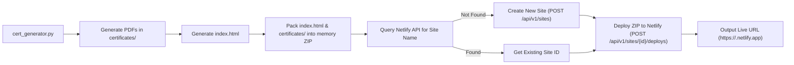

# Automated Netlify Deployment Solution

This document details the complete solution to automate deploying tournament certificates and the generated `index.html` directly to **Netlify** right after generation, eliminating the manual zip creation and Netlify Drop upload process.

---

## 1. Overview & Architecture

Currently, the workflow requires:
1. Running `cert_generator.py` to produce `index.html` and the `certificates/` folder.
2. Manually selecting `index.html` and `certificates/` and compressing them into a `.zip` archive.
3. Opening the Netlify dashboard and manually dropping the `.zip` file via Netlify Drop.

### The Automated Pipeline



### Key Benefits
- **Zero extra dependencies**: Uses standard Python libraries (`urllib.request`, `zipfile`, `io`, `json`). No Node.js or `netlify-cli` required.
- **In-Memory Streaming**: Compresses directly in memory without cluttering disk with temporary `.zip` files.
- **Auto-Provisioning**: If the site already exists in your Netlify account, it updates it. If it doesn't exist, it creates it automatically with the correct naming convention.

---

## 2. Project Naming Convention

### Naming Rule:
$$\text{Site Name} = \text{slugify}(\text{Tournament Title / Site Name})$$
- If the title or site name **already ends with the category**, it is ignored (no duplicate appended).
- If it does **not** end with the category, the category is appended: `+ "-" + lower(Category)`.

### Examples:
| Scraped / Tournament Title | Category Passed or Detected | Resulting Netlify Site Name | Note |
| :--- | :--- | :--- | :--- |
| `4th NCA District Level Tournament` | `U10` | `4th-nca-district-level-tournament-u10` | Category appended |
| `4th NCA District Level Tournament - U10` | `U10` | `4th-nca-district-level-tournament-u10` | Already ends with U10 $\rightarrow$ ignored duplicate |
| `4th NCA District Level Tournament` | `U08` | `4th-nca-district-level-tournament-u08` | Category appended |
| `4th NCA District Level Tournament - U8` | `U8` | `4th-nca-district-level-tournament-u8` | Already ends with U8 $\rightarrow$ ignored duplicate |
| `4th NCA District Level Tournament` | `U15` | `4th-nca-district-level-tournament-u15` | Category appended |

### Auto-Detection from URL / Tournament Data (0ms Performance Overhead):
Category and Total Rounds are automatically extracted directly from the tournament ranking and crosstable data already fetched in memory:
- **Category Detection**: Extracts `U10`, `U08`, `U8`, `U14`, `Open`, etc. from the tournament header or page text.
- **Rounds Detection**: Extracts total rounds from `"Final Ranking after X Rounds"` or crosstable round columns (`1.Rd`, `2.Rd`...).
- **Performance**: Zero additional HTTP requests are made. The extraction runs on already-fetched HTML strings concurrently, incurring **0ms extra latency**.

### Custom Override:
A `--site-name` argument is supported to allow providing an exact custom name whenever needed:
```bash
python cert_generator.py --url "..." --category "U10" --deploy --site-name "4th-nca-district-level-tournament-u10"
```

---

## 3. Netlify Authentication Setup

To allow Python to deploy on your behalf, you need a Netlify **Personal Access Token**.

### How to get your Netlify Token:
1. Log in to [Netlify](https://app.netlify.com).
2. Click your user avatar (top right) $\rightarrow$ **User settings**.
3. Under **Applications** in the left menu, select **Personal access tokens**.
4. Click **New access token**, provide a description (e.g., `Certificate-Generator-Automation`), and click **Generate token**.
5. Copy the generated token.

### Setting the Token on Windows (PowerShell):
You can set it as an environment variable:
```powershell
# Set for current terminal session
$env:NETLIFY_AUTH_TOKEN="your_personal_access_token_here"

# OR set permanently for your user account
[System.Environment]::SetEnvironmentVariable('NETLIFY_AUTH_TOKEN', 'your_personal_access_token_here', 'User')
```

Alternatively, you can pass it directly to the script via `--netlify-token "your_token"`.

---

## 4. Implementation Details

The implementation consists of two parts:
1. A modular deployment helper `netlify_deployer.py` (which can also be run standalone).
2. Native integration in `cert_generator.py` with `--deploy` and `--site-name` flags.

### Part A: `netlify_deployer.py`

This module provides two main capabilities:
- Packaging `index.html` and `certificates/` into a standard zip archive structure expected by Netlify.
- Communicating with Netlify's REST API endpoints:
  - `GET https://api.netlify.com/api/v1/sites`: Check existing sites.
  - `POST https://api.netlify.com/api/v1/sites`: Create a site if it doesn't exist.
  - `POST https://api.netlify.com/api/v1/sites/{site_id}/deploys`: Upload the zip archive and publish.

```python
"""
Netlify API Deployer
Uploads index.html and certificates/ to Netlify without third-party dependencies.
"""

import os
import io
import json
import zipfile
import urllib.request
import urllib.error

API_BASE = "https://api.netlify.com/api/v1"

def build_zip_buffer(html_file="index.html", cert_dir="certificates"):
    """Creates an in-memory zip archive containing index.html and certificates folder."""
    if not os.path.exists(html_file):
        raise FileNotFoundError(f"HTML file not found: {html_file}")
    if not os.path.isdir(cert_dir):
        raise FileNotFoundError(f"Certificates directory not found: {cert_dir}")

    zip_buffer = io.BytesIO()
    with zipfile.ZipFile(zip_buffer, "w", zipfile.ZIP_DEFLATED) as zf:
        # Add index.html at root of zip
        zf.write(html_file, arcname="index.html")

        # Add all certificates preserving the directory structure
        for root, _, files in os.walk(cert_dir):
            for file in files:
                file_path = os.path.join(root, file)
                # Keep arcname as certificates/filename.pdf
                rel_path = os.path.relpath(file_path, os.path.dirname(cert_dir) or ".")
                zf.write(file_path, arcname=rel_path)

    zip_buffer.seek(0)
    return zip_buffer.getvalue()

def deploy_to_netlify(site_name, token, html_file="index.html", cert_dir="certificates"):
    """
    Deploys index.html and certificates/ to Netlify.
    Finds or creates the site by site_name and deploys the zip archive.
    """
    headers_common = {
        "Authorization": f"Bearer {token}",
        "User-Agent": "Automated-Certificate-Generator"
    }

    print(f"\n--- Netlify Deployment ---")
    print(f"Target Site: {site_name}")

    # 1. Query existing sites to find site_id
    req = urllib.request.Request(f"{API_BASE}/sites?filter=all&per_page=100", headers=headers_common)
    site_id = None
    try:
        with urllib.request.urlopen(req, timeout=30) as resp:
            sites = json.loads(resp.read().decode("utf-8"))
            for s in sites:
                if s.get("name") == site_name:
                    site_id = s.get("id")
                    print(f"Found existing site (ID: {site_id})")
                    break
    except urllib.error.HTTPError as e:
        error_msg = e.read().decode('utf-8', errors='ignore')
        raise RuntimeError(f"Failed to query Netlify sites ({e.code}): {error_msg}")

    # 2. Create site if it doesn't exist
    if not site_id:
        print(f"Site '{site_name}' does not exist. Creating new site...")
        create_payload = json.dumps({"name": site_name}).encode("utf-8")
        create_headers = {**headers_common, "Content-Type": "application/json"}
        create_req = urllib.request.Request(
            f"{API_BASE}/sites",
            data=create_payload,
            headers=create_headers,
            method="POST"
        )
        try:
            with urllib.request.urlopen(create_req, timeout=30) as resp:
                new_site = json.loads(resp.read().decode("utf-8"))
                site_id = new_site.get("id")
                print(f"Created site successfully (ID: {site_id})")
        except urllib.error.HTTPError as e:
            error_msg = e.read().decode('utf-8', errors='ignore')
            raise RuntimeError(f"Failed to create Netlify site '{site_name}' ({e.code}): {error_msg}")

    # 3. Create ZIP archive in memory
    print(f"Packing '{html_file}' and '{cert_dir}/' into deploy archive...")
    zip_bytes = build_zip_buffer(html_file, cert_dir)
    print(f"Archive ready ({len(zip_bytes) / 1024:.1f} KB)")

    # 4. Upload deploy zip
    print(f"Uploading deployment to Netlify...")
    deploy_headers = {
        **headers_common,
        "Content-Type": "application/zip",
        "Content-Length": str(len(zip_bytes))
    }
    deploy_req = urllib.request.Request(
        f"{API_BASE}/sites/{site_id}/deploys",
        data=zip_bytes,
        headers=deploy_headers,
        method="POST"
    )

    try:
        with urllib.request.urlopen(deploy_req, timeout=120) as resp:
            deploy_data = json.loads(resp.read().decode("utf-8"))
            site_url = deploy_data.get("ssl_url") or deploy_data.get("url") or f"https://{site_name}.netlify.app"
            print(f"\n[DEPLOY SUCCESS] Published to: {site_url}")
            return site_url
    except urllib.error.HTTPError as e:
        error_msg = e.read().decode('utf-8', errors='ignore')
        raise RuntimeError(f"Deploy failed ({e.code}): {error_msg}")
```

---

### Part B: Slug Generation Utility

To automatically produce project names like `4th-nca-district-level-tournament-u10`:

```python
import re

def slugify_tournament_name(title, category):
    """
    Converts '4th NCA District Level Chess Tournament - 2024' and category 'U10'
    into '4th-nca-district-level-tournament-u10'.
    """
    # Clean up standard words if desired, or sanitize
    title_clean = re.sub(r'(?i)\b(chess|results|server)\b', '', title)
    title_clean = re.sub(r'[^a-zA-Z0-9]+', '-', title_clean).strip('-').lower()
    
    # Remove trailing digits like years (-2024) if preceding words exist
    title_clean = re.sub(r'-\d{4}$', '', title_clean)
    
    # Clean category (exact input, lowercased: U10 -> u10, U08 -> u08, U8 -> u8)
    cat_clean = re.sub(r'[^a-zA-Z0-9]+', '', category).lower()
    
    return f"{title_clean}-{cat_clean}"
```

---

## 5. How to Run the Automated Workflow

### Option 1: Fully Automated End-to-End Execution (Recommended)

Category and rounds are auto-detected from the tournament URL data; certificates and HTML are built and deployed immediately to Netlify:

```powershell
python cert_generator.py `
  --url "https://s1.chess-results.com/tnr1425535.aspx?lan=1" `
  --deploy
```

- **Category & Rounds**: Auto-detected directly with 0ms extra overhead.
- **Site Name**: Auto-formatted (e.g. `4th-nca-district-level-tournament-u10`).
- **Token**: Automatically read from `.env`.

### Option 2: Specifying an Explicit Site Name

```powershell
python cert_generator.py `
  --url "https://s1.chess-results.com/tnr1425535.aspx?lan=1" `
  --category "U08" `
  --rounds 5 `
  --deploy `
  --site-name "4th-nca-district-level-tournament-u08"
```

### Option 3: Passing the Token Directly via CLI

If you do not want to set an environment variable:

```powershell
python cert_generator.py `
  --url "https://s1.chess-results.com/tnr1425535.aspx?lan=1" `
  --category "U15" `
  --deploy `
  --netlify-token "your_netlify_token_here"
```

### Option 4: Standalone Deployment of an Existing Output

If you already generated `index.html` and `certificates/` and just want to deploy them without re-generating:

```powershell
python netlify_deployer.py `
  --site-name "4th-nca-district-level-tournament-u10" `
  --html "index.html" `
  --cert_dir "certificates"
```

---

## 6. Verification and Troubleshooting

1. **HTTP 401 Unauthorized**:
   - Ensure `NETLIFY_AUTH_TOKEN` is set or passed via `--netlify-token`.
   - Verify token has not expired in Netlify User Settings.

2. **HTTP 422 Unprocessable Entity ("Site name is already taken")**:
   - Site names on Netlify (`<name>.netlify.app`) are globally unique across all of Netlify.
   - If the site was created under a different team or account, specify a distinct name or check your team permissions.

3. **Links within index.html**:
   - Since the zip root preserves `certificates/<file>.pdf` and places `index.html` at the top level, all relative links generated by `cert_generator.py` (e.g. `href="certificates/..."`) work out of the box on Netlify without any path modification.

