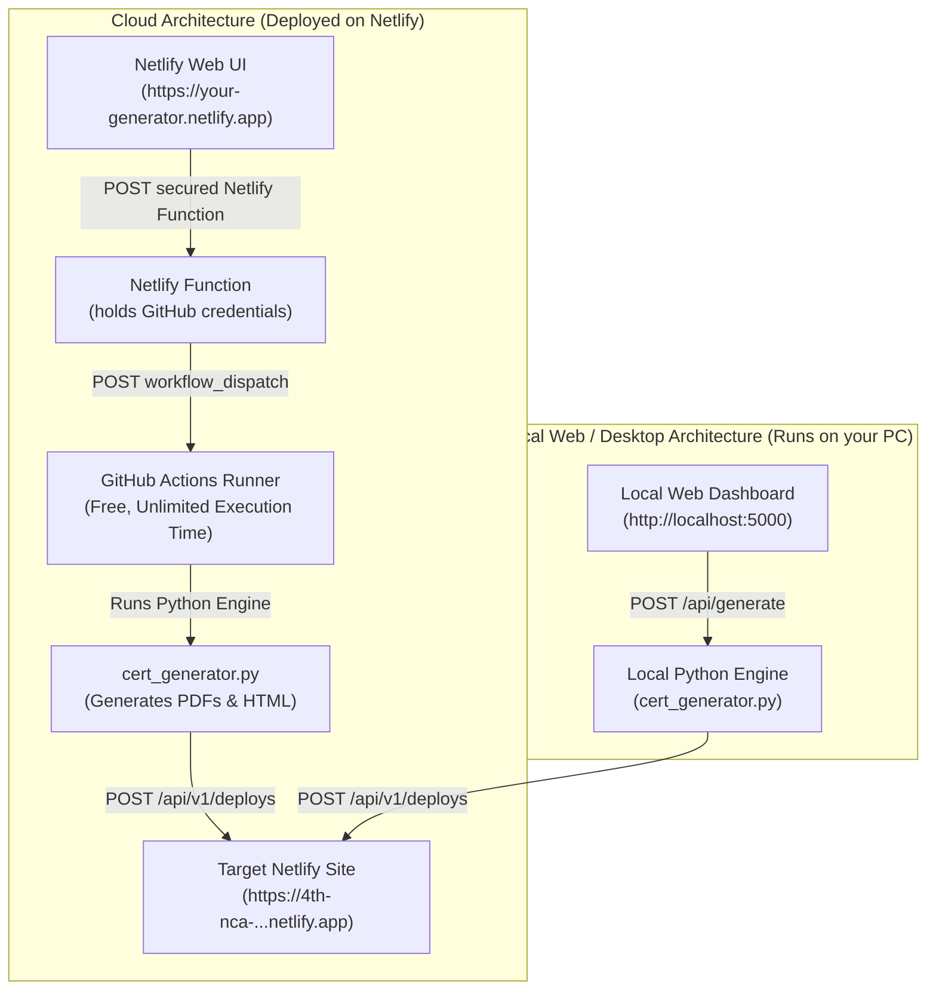

# UI Architecture & Netlify Deployment Plan

This document details the architectural plan, technical feasibility, and implementation options for providing a Graphical User Interface (UI) for the **Automated Certificate Generator**, including how it can be deployed on **Netlify**.

---

## 1. Executive Summary & Feasibility Analysis

### Can the UI be deployed to Netlify?
**Yes, but with an important architectural distinction between the Frontend and the Processing Engine:**

| Component | Can it run directly on Netlify? | Explanation |
| :--- | :--- | :--- |
| **User Interface (UI)** | **YES (100%)** | The interactive web form (URL input, checkboxes, category, rounds, site name, Process button) can be hosted directly on Netlify as a static web application. |
| **PDF Generation Engine** | **Requires Runner / Backend** | Netlify is primarily a static host and serverless platform. Netlify Functions have strict execution timeout limits (10 to 26 seconds maximum). Scraping a tournament, generating dozens or hundreds of high-resolution PDF certificates with ReportLab/Pillow, and deploying to Netlify can take 30–60+ seconds, exceeding serverless limits. |

---

## 2. Recommended Architectures

### Approach 1: Netlify Web UI + GitHub Actions Engine (100% Cloud)
- **UI Location**: Deployed as a web page on Netlify (e.g. `https://nca-cert-generator.netlify.app`).
- **How it works**:
  1. You open the Netlify page from any browser (PC or mobile).
  2. You enter the chess-results URL and toggle settings.
  3. Clicking **Process** calls a credential-protected Netlify Function.
  4. The function reads the GitHub token from Netlify environment variables and triggers `workflow_dispatch`.
  5. GitHub Actions runs `cert_generator.py` on an Ubuntu runner and deploys the generated certificates to the target Netlify tournament site.
- **Pros**: Access from anywhere; no local Python runtime needed on the client device.

### Approach 2: Local Web UI Dashboard (Zero Setup, Instant)
- **UI Location**: Runs a lightweight local web server on your machine (`gui_server.py`).
- **How it works**:
  1. Double-click `run_ui.bat` or run `python gui_server.py`.
  2. Opens in your browser at `http://localhost:5000`.
  3. Interactive web form with real-time live log output streaming progress.
  4. Generates certificates locally and deploys to Netlify in real-time.
- **Pros**: Instant startup, works offline/locally, real-time console feedback, zero third-party cloud bridges.

---

## 3. UI Features & Controls Specification

The UI includes all requested fields and features:

| Field | Type | Default | Description |
| :--- | :--- | :--- | :--- |
| **Tournament URL** | Text Input | Required | Chess-results tournament URL (`https://s1.chess-results.com/...`) |
| **Deploy to Netlify** | Toggle / Checkbox | Checked (`True`) | Automatically deploys upon generation |
| **Category** | Text Input | Optional (Blank) | Auto-detected from URL/page if left empty (e.g. `U10`) |
| **Total Rounds** | Number Input | Optional (Blank) | Auto-detected from URL/page if left empty (e.g. `5`) |
| **Site Name Override** | Text Input | Optional (Blank) | Auto-formatted if blank; handles category duplicate avoidance |
| **Process Button** | Action Button | Active | Triggers the generation & deployment pipeline with live feedback |
| **Live Log Console** | Terminal Box | Dynamic | Streams live execution logs, progress, and the final URL |

---

## 4. Implementation Plan

### Phase 1: Unified Web Application Interface (`web/index.html`)
- Build a single-page responsive dashboard with modern, clean UI styling.
- Form inputs for URL, Deploy checkbox, Category, Rounds, Site Name.
- Live progress indicator, terminal output log, and clickable Netlify link card.
- Works in **Dual Mode**:
  1. **Local Mode**: Sends requests to local `gui_server.py` (`/api/generate`).
  2. **Netlify Mode**: Deployed on Netlify; triggers GitHub Actions workflow dispatch.

### Phase 2: Local Web Server (`gui_server.py` + `run_ui.bat`)
- Pure Python standard library server (`http.server` + threading).
- Zero external pip dependencies needed.
- Captures `sys.stdout` and streams progress line-by-line to the UI via Server-Sent Events (SSE) or polling.
- Double-clickable `run_ui.bat` script for one-click startup on Windows.

### Phase 3: Cloud Netlify Deployment Files
- Use `.github/workflows/generate_and_deploy.yml` for cloud execution.
- Configure `web/netlify.toml` and `web/netlify/functions/dispatch.js` to securely dispatch the workflow without exposing the GitHub token to the browser.
- Store the repository, workflow ref, GitHub token, and dashboard access key in Netlify environment variables.
